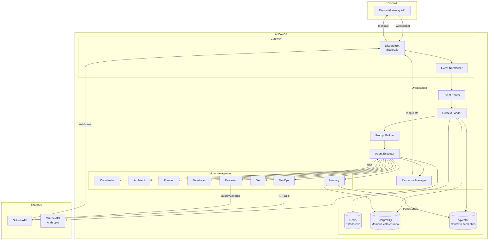
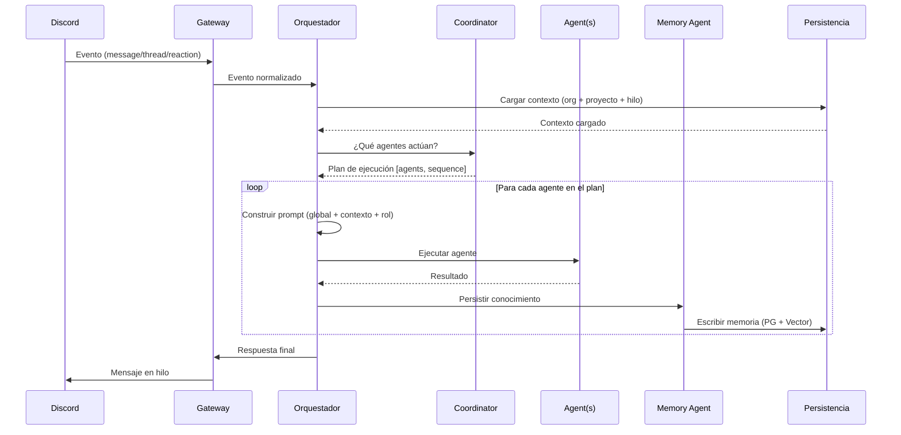
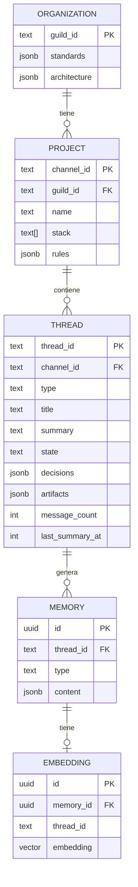

# Diseño Técnico — AI DevOS (Discord)

## Overview

AI DevOS es un sistema operativo de desarrollo multi-agente construido sobre Discord. El sistema sigue una arquitectura event-driven donde un Gateway sin lógica captura eventos de Discord, un Orquestador central los procesa cargando contexto en 3 niveles (org, proyecto, hilo), y un Motor de Agentes ejecuta 8 roles especializados contra LLMs. La persistencia opera en 3 capas: Redis para estado vivo, PostgreSQL para memoria estructurada y una base de datos vectorial para contexto semántico.

El flujo principal es:

```
Discord Event → Gateway → Normalize → Orquestador → Load Context → Coordinator Agent → Build Prompt → Execute Agent(s) → Store Memory → Respond to Discord
```

### Decisiones de Diseño Clave

1. **Gateway sin lógica**: El bot de Discord es un proxy puro. Toda la lógica reside en el Orquestador. Esto permite escalar, testear y reemplazar el Gateway sin afectar el sistema.
2. **Coordinator como punto de decisión único**: Ningún agente se auto-invoca. El Coordinator decide siempre qué agentes actúan y en qué orden.
3. **Prompts compuestos dinámicamente**: Cada ejecución de agente recibe un prompt construido en capas (global + contexto + rol + steering), nunca historial completo.
4. **Persistencia en 3 capas**: Cada capa tiene un propósito distinto — Redis para velocidad, Postgres para estructura, Vector DB para semántica.
5. **Stack tecnológico**: TypeScript (Node.js) como lenguaje principal, discord.js para el Gateway, Redis (ioredis), PostgreSQL (pg/drizzle-orm), pgvector como Vector DB integrado en Postgres, y Claude como LLM principal vía API de Anthropic.

## Arquitectura

### Diagrama de Componentes



### Diagrama de Flujo Principal




## Componentes e Interfaces

### 1. Gateway (`src/gateway/`)

Componente proxy sin lógica de negocio. Escucha eventos de Discord y webhooks de GitHub, los normaliza y los reenvía al Orquestador.

```typescript
// Evento normalizado — formato único de salida del Gateway
interface NormalizedEvent {
  id: string;
  type: 'message' | 'thread_create' | 'reaction_add' | 'slash_command' | 'github_webhook';
  guildId: string;      // servidor Discord
  channelId: string;    // canal = proyecto
  threadId?: string;    // hilo = tarea
  userId: string;       // autor del evento
  timestamp: number;
  payload: MessagePayload | ThreadPayload | ReactionPayload | SlashCommandPayload | GitHubWebhookPayload;
}

interface MessagePayload {
  content: string;
  authorIsBot: boolean;
}

interface ThreadPayload {
  name: string;
  parentChannelId: string;
}

interface ReactionPayload {
  emoji: '✅' | '❌' | '🔁' | '🚀';
  messageId: string;
  targetAgentRole?: AgentRole;
}

interface SlashCommandPayload {
  command: 'start' | 'plan' | 'code' | 'review' | 'test' | 'deploy' | 'summary';
  options?: Record<string, string>;
}

interface GitHubWebhookPayload {
  action: 'opened' | 'closed' | 'synchronize' | 'review_submitted';
  prNumber: number;
  prTitle: string;
  prUrl: string;
  repository: string;
  author: string;
}

// Interfaz pública del Gateway
interface Gateway {
  start(): Promise<void>;
  stop(): Promise<void>;
  sendMessage(channelOrThreadId: string, content: string): Promise<void>;
  createThread(channelId: string, name: string): Promise<string>;
  registerSlashCommands(): Promise<void>;
}
```

### 2. Orquestador (`src/orchestrator/`)

Componente central event-driven. Recibe eventos normalizados, carga contexto, invoca al Coordinator, ejecuta agentes en secuencia y gestiona respuestas.

```typescript
interface Orchestrator {
  handleEvent(event: NormalizedEvent): Promise<void>;
}

// Sub-componentes internos del Orquestador
interface EventRouter {
  route(event: NormalizedEvent): Promise<RoutingDecision>;
}

interface RoutingDecision {
  shouldProcess: boolean;
  contextKeys: { orgId: string; projectId: string; threadId?: string };
}

interface ContextLoader {
  load(keys: RoutingDecision['contextKeys']): Promise<FullContext>;
}

interface FullContext {
  org: OrgContext;
  project: ProjectContext;
  thread?: ThreadContext;
}

interface PromptBuilder {
  build(context: FullContext, agentRole: AgentRole, taskDescription: string): string;
}

interface AgentExecutor {
  execute(prompt: string, agentRole: AgentRole): Promise<AgentResult>;
}

interface AgentResult {
  role: AgentRole;
  output: string;
  structured?: Record<string, unknown>;  // JSON estructurado (Memory Agent)
  success: boolean;
  error?: string;
}

interface ResponseManager {
  send(event: NormalizedEvent, results: AgentResult[]): Promise<void>;
}
```

### 3. Motor de Agentes (`src/agents/`)

Cada agente implementa una interfaz común. El Coordinator es especial: devuelve un plan de ejecución en vez de contenido.

```typescript
type AgentRole = 'coordinator' | 'architect' | 'planner' | 'developer' | 'reviewer' | 'qa' | 'devops' | 'memory';

interface Agent {
  role: AgentRole;
  execute(context: FullContext, taskDescription: string): Promise<AgentResult>;
}

// El Coordinator devuelve un plan, no contenido
interface ExecutionPlan {
  agents: AgentRole[];       // secuencia ordenada
  reason: string;            // justificación del plan
}

// Prompt de rol — cada agente tiene su prompt específico
interface AgentPromptConfig {
  role: AgentRole;
  systemPrompt: string;      // prompt de rol fijo
}
```

### 4. Persistencia (`src/persistence/`)

Tres stores con responsabilidades distintas.

```typescript
interface RedisStore {
  getThreadState(threadId: string): Promise<ThreadState | null>;
  setThreadState(threadId: string, state: ThreadState): Promise<void>;
  getActiveSession(threadId: string): Promise<SessionData | null>;
  setActiveSession(threadId: string, session: SessionData): Promise<void>;
  incrementMessageCount(threadId: string): Promise<number>;
}

interface PostgresStore {
  // Organizaciones
  getOrg(guildId: string): Promise<OrgContext>;
  upsertOrg(guildId: string, data: Partial<OrgContext>): Promise<void>;
  
  // Proyectos
  getProject(channelId: string): Promise<ProjectContext>;
  upsertProject(channelId: string, data: Partial<ProjectContext>): Promise<void>;
  
  // Threads
  getThread(threadId: string): Promise<ThreadContext>;
  upsertThread(threadId: string, data: Partial<ThreadContext>): Promise<void>;
  
  // Memoria
  storeMemory(entry: MemoryEntry): Promise<void>;
  getMemories(threadId: string): Promise<MemoryEntry[]>;
}

interface VectorStore {
  store(embedding: number[], metadata: VectorMetadata): Promise<void>;
  query(embedding: number[], topK: number): Promise<VectorResult[]>;
}

interface VectorMetadata {
  threadId: string;
  type: 'decision' | 'pattern' | 'error' | 'summary';
  content: string;
  timestamp: number;
}

interface VectorResult {
  metadata: VectorMetadata;
  score: number;
}
```

### 5. GitHub Integration (`src/github/`)

```typescript
interface GitHubClient {
  approvePR(repo: string, prNumber: number): Promise<void>;
  mergePR(repo: string, prNumber: number): Promise<void>;
  createReviewComment(repo: string, prNumber: number, body: string): Promise<void>;
}
```


## Modelos de Datos

### Esquema PostgreSQL

```sql
-- Organizaciones (1 por servidor Discord)
CREATE TABLE organizations (
  guild_id      TEXT PRIMARY KEY,
  standards     JSONB NOT NULL DEFAULT '[]',
  architecture  JSONB NOT NULL DEFAULT '[]',
  created_at    TIMESTAMPTZ NOT NULL DEFAULT NOW(),
  updated_at    TIMESTAMPTZ NOT NULL DEFAULT NOW()
);

-- Proyectos (1 por canal Discord)
CREATE TABLE projects (
  channel_id    TEXT PRIMARY KEY,
  guild_id      TEXT NOT NULL REFERENCES organizations(guild_id),
  name          TEXT NOT NULL,
  stack         TEXT[] NOT NULL DEFAULT '{}',
  rules         JSONB NOT NULL DEFAULT '[]',
  created_at    TIMESTAMPTZ NOT NULL DEFAULT NOW(),
  updated_at    TIMESTAMPTZ NOT NULL DEFAULT NOW()
);

-- Threads (1 por hilo Discord)
CREATE TABLE threads (
  thread_id     TEXT PRIMARY KEY,
  channel_id    TEXT NOT NULL REFERENCES projects(channel_id),
  type          TEXT NOT NULL CHECK (type IN ('feature', 'bug', 'pr', 'task')),
  title         TEXT NOT NULL,
  summary       TEXT NOT NULL DEFAULT '',
  state         TEXT NOT NULL DEFAULT 'open' CHECK (state IN ('open', 'in_progress', 'review', 'done')),
  decisions     JSONB NOT NULL DEFAULT '[]',
  artifacts     JSONB NOT NULL DEFAULT '[]',
  message_count INTEGER NOT NULL DEFAULT 0,
  last_summary_at INTEGER NOT NULL DEFAULT 0,  -- message_count al último resumen
  created_at    TIMESTAMPTZ NOT NULL DEFAULT NOW(),
  updated_at    TIMESTAMPTZ NOT NULL DEFAULT NOW()
);

-- Memoria persistente
CREATE TABLE memories (
  id            UUID PRIMARY KEY DEFAULT gen_random_uuid(),
  thread_id     TEXT NOT NULL REFERENCES threads(thread_id),
  type          TEXT NOT NULL CHECK (type IN ('decision', 'pattern', 'error', 'summary')),
  content       JSONB NOT NULL,
  created_at    TIMESTAMPTZ NOT NULL DEFAULT NOW()
);

-- Embeddings vectoriales (pgvector)
CREATE TABLE embeddings (
  id            UUID PRIMARY KEY DEFAULT gen_random_uuid(),
  memory_id     UUID REFERENCES memories(id),
  thread_id     TEXT NOT NULL,
  type          TEXT NOT NULL,
  content_text  TEXT NOT NULL,
  embedding     vector(1536) NOT NULL,
  created_at    TIMESTAMPTZ NOT NULL DEFAULT NOW()
);

CREATE INDEX idx_embeddings_vector ON embeddings USING ivfflat (embedding vector_cosine_ops);
CREATE INDEX idx_threads_channel ON threads(channel_id);
CREATE INDEX idx_memories_thread ON memories(thread_id);
```

### Esquema Redis

```
# Estado vivo de thread
thread:{threadId}:state     → JSON { type, state, message_count, last_summary_at }

# Sesión activa (plan de ejecución en curso)
thread:{threadId}:session   → JSON { plan: AgentRole[], currentIndex: number, results: AgentResult[] }

# Contador de mensajes desde último resumen
thread:{threadId}:msg_count → INTEGER
```

### Tipos TypeScript del Modelo de Datos

```typescript
interface OrgContext {
  guildId: string;
  standards: string[];
  architecture: string[];
}

interface ProjectContext {
  channelId: string;
  guildId: string;
  name: string;
  stack: string[];
  rules: string[];
}

type ThreadType = 'feature' | 'bug' | 'pr' | 'task';
type ThreadState = 'open' | 'in_progress' | 'review' | 'done';

interface ThreadContext {
  threadId: string;
  channelId: string;
  type: ThreadType;
  title: string;
  summary: string;
  state: ThreadState;
  decisions: Decision[];
  artifacts: Artifact[];
  messageCount: number;
  lastSummaryAt: number;
}

interface Decision {
  description: string;
  madeBy: AgentRole;
  timestamp: number;
}

interface Artifact {
  type: 'code' | 'plan' | 'review' | 'test' | 'deployment';
  content: string;
  agentRole: AgentRole;
  timestamp: number;
}

interface MemoryEntry {
  id: string;
  threadId: string;
  type: 'decision' | 'pattern' | 'error' | 'summary';
  content: Record<string, unknown>;
  timestamp: number;
}

interface SessionData {
  plan: AgentRole[];
  currentIndex: number;
  results: AgentResult[];
}
```

### Diagrama Entidad-Relación




## Correctness Properties

*Una propiedad es una característica o comportamiento que debe mantenerse verdadero en todas las ejecuciones válidas de un sistema — esencialmente, una declaración formal sobre lo que el sistema debe hacer. Las propiedades sirven como puente entre especificaciones legibles por humanos y garantías de corrección verificables por máquinas.*

### Property 1: Normalización de eventos preserva estructura completa

*Para cualquier* evento de Discord (message, thread_create, reaction_add), la función de normalización del Gateway debe producir un NormalizedEvent que contenga: id, type, guildId, channelId, userId, timestamp y el payload correspondiente al tipo de evento, sin aplicar transformaciones de lógica de negocio al contenido.

**Validates: Requirements 1.1, 1.2**

### Property 2: Construcción de prompts incluye todas las capas

*Para cualquier* combinación de FullContext y AgentRole, el prompt construido por PromptBuilder debe contener: (1) el Prompt_Global, (2) los datos de Org_Context, Project_Context y Thread_Context del Prompt_de_Contexto, (3) el prompt de rol específico del agente asignado, y (4) las reglas de steering/interpretación.

**Validates: Requirements 3.1, 3.2, 3.4, 3.5**

### Property 3: Prompt usa resumen en lugar de historial completo

*Para cualquier* ThreadContext que tenga un resumen no vacío, el prompt construido debe incluir el resumen del hilo y no debe incluir los mensajes individuales anteriores al punto de resumen.

**Validates: Requirements 3.3, 8.3**

### Property 4: Coordinator asigna agentes según estado del hilo

*Para cualquier* FullContext, el ExecutionPlan producido por el Coordinator debe seguir las reglas: hilo nuevo → [architect, planner]; implementación requerida → incluye developer; código existente → incluye [reviewer, qa]; código aprobado → incluye devops.

**Validates: Requirements 4.2, 4.3, 4.4, 4.5**

### Property 5: Output de agentes contiene secciones requeridas por rol

*Para cualquier* agente y contexto válido, el AgentResult producido debe contener todas las secciones requeridas por su rol: Architect → [overview, componentes, flujo de datos, riesgos]; Planner → [tareas, dependencias, edge cases, complejidad]; Reviewer → [issues, severidad, sugerencias, veredicto]; QA → [test cases, edge cases, failure scenarios]; DevOps → [build steps, CI/CD config, deployment strategy]; Memory → [JSON con decisions, patterns, errors].

**Validates: Requirements 4.6, 4.7, 4.9, 4.10, 4.11, 4.12**

### Property 6: Ejecución secuencial del plan con persistencia

*Para cualquier* ExecutionPlan con N agentes, el Orquestador debe ejecutar los agentes en el orden exacto especificado, y después de cada ejecución de agente debe invocar al Memory_Agent para persistir el conocimiento generado.

**Validates: Requirements 2.3, 2.4**

### Property 7: Continuidad del plan ante fallo de agente

*Para cualquier* ExecutionPlan donde un agente falla, el Orquestador debe registrar el error, notificar en el hilo de Discord, y continuar ejecutando los agentes restantes del plan sin interrumpir la secuencia.

**Validates: Requirements 2.6**

### Property 8: Reacciones invocan al agente correcto según contexto

*Para cualquier* reacción en un mensaje de agente, el sistema debe invocar al agente correcto: ✅ → Reviewer o DevOps según el estado del hilo; ❌ → Developer; 🔁 → el agente que produjo el mensaje original; 🚀 → DevOps.

**Validates: Requirements 6.4, 6.5, 6.6, 6.7**

### Property 9: Trigger de resumen automático cada 15 mensajes

*Para cualquier* hilo con un contador de mensajes, cuando la diferencia entre el contador actual y el último punto de resumen alcanza 15, el Memory_Agent debe ser invocado para generar un resumen automático con decisiones, estado actual e issues abiertos.

**Validates: Requirements 8.1**

### Property 10: Persistencia dual consistente

*Para cualquier* operación de persistencia del Memory_Agent, los datos deben escribirse tanto en Postgres_Store (JSON estructurado) como en Vector_Store (embedding), y cuando un thread cambia de estado, el estado debe actualizarse tanto en Redis_Store como en Postgres_Store.

**Validates: Requirements 5.4, 5.5, 8.2**

### Property 11: Webhook de GitHub produce hilo de tipo PR

*Para cualquier* webhook de GitHub con action "opened", el Gateway debe producir un evento normalizado de tipo "github_webhook" y el Orquestador debe crear un hilo de tipo "pr" con los detalles del PR (número, título, URL, repositorio, autor).

**Validates: Requirements 9.1**

### Property 12: Retry con backoff exponencial

*Para cualquier* webhook de GitHub que falla en su procesamiento, el sistema debe reintentar hasta 3 veces con backoff exponencial, donde el delay del intento N es mayor que el delay del intento N-1.

**Validates: Requirements 9.5**

### Property 13: Detección de errores crea hilos de bug

*Para cualquier* mensaje o log que contiene un patrón de error reconocible, el Orquestador debe crear automáticamente un hilo de tipo "bug" con el contexto del error. Para mensajes sin patrones de error, no debe crearse ningún hilo automático.

**Validates: Requirements 10.1**

### Property 14: Debate multi-agente se limita a 4 turnos

*Para cualquier* debate multi-agente entre Architect y Reviewer, si después de 4 turnos no se alcanza consenso, el Coordinator debe detener el debate, generar un resumen de posiciones y solicitar decisión al usuario.

**Validates: Requirements 10.4**

### Property 15: Clasificación de hilos nuevos

*Para cualquier* hilo nuevo creado en Discord, el Orquestador debe clasificarlo como uno de los tipos válidos (feature, bug, pr, task), crear su estado inicial en los stores, y ejecutar el Coordinator_Agent.

**Validates: Requirements 6.1**


## Error Handling

### Estrategia General

El sistema sigue un modelo de "fail-forward": cuando un componente falla, el sistema registra el error, notifica al usuario y continúa operando. Nunca se detiene el flujo completo por un fallo individual.

### Errores por Componente

#### Gateway
| Error | Causa | Manejo |
|-------|-------|--------|
| Desconexión WebSocket | Discord caído, red inestable | Reconexión automática con backoff exponencial (1s, 2s, 4s, 8s, max 30s) |
| Evento malformado | Payload inesperado de Discord | Log del evento raw, descartarlo, continuar escuchando |
| Webhook GitHub fallido | GitHub timeout, payload inválido | Retry hasta 3 veces con backoff exponencial (1s, 2s, 4s) |
| Rate limit Discord | Demasiados mensajes | Respetar headers de rate limit, encolar mensajes con delay |

#### Orquestador
| Error | Causa | Manejo |
|-------|-------|--------|
| Contexto no encontrado | Guild/channel/thread sin datos | Crear contexto por defecto con valores vacíos, continuar |
| Agente falla | LLM timeout, respuesta inválida | Registrar error, notificar en hilo ("⚠️ {agent} falló: {reason}"), continuar con siguiente agente del plan |
| Plan vacío del Coordinator | Contexto insuficiente para decidir | Responder al usuario pidiendo más contexto |
| Timeout de ejecución | Agente tarda más de 60s | Cancelar ejecución, registrar timeout, continuar plan |

#### Persistencia
| Error | Causa | Manejo |
|-------|-------|--------|
| Redis no disponible | Redis caído | Fallback a Postgres para estado, log warning |
| Postgres no disponible | DB caída | Encolar escrituras en memoria (max 100), reintentar cada 30s |
| Vector Store falla | pgvector error | Log error, continuar sin embedding (degradación graceful) |
| Inconsistencia Redis/Postgres | Escritura parcial | Postgres es fuente de verdad, Redis se reconcilia en próxima lectura |

#### LLM (Claude API)
| Error | Causa | Manejo |
|-------|-------|--------|
| Rate limit | Demasiadas requests | Retry con backoff, encolar requests |
| Timeout | Respuesta lenta | Timeout a 60s, retry 1 vez, luego fallar agente |
| Respuesta inválida | Output no parseable | Retry 1 vez con prompt más explícito, luego fallar agente |
| API no disponible | Servicio caído | Notificar en Discord, pausar ejecución de agentes |

### Formato de Notificación de Errores en Discord

```
⚠️ Error en {component}
Agente: {agent_role}
Hilo: {thread_title}
Error: {error_message}
Acción: {recovery_action}
```

## Testing Strategy

### Enfoque Dual: Unit Tests + Property-Based Tests

El sistema se testea con dos estrategias complementarias:

1. **Property-Based Tests (PBT)**: Verifican propiedades universales con inputs generados aleatoriamente. Cada propiedad del documento de diseño se implementa como un test PBT con mínimo 100 iteraciones.
2. **Unit Tests**: Verifican ejemplos específicos, edge cases, mapeos directos (comandos slash → agentes) y flujos de integración con mocks.

### Librería PBT

- **fast-check** para TypeScript — librería madura de property-based testing para Node.js.

### Property-Based Tests

Cada propiedad de la sección Correctness Properties se implementa como un test PBT:

| Property | Test | Generadores |
|----------|------|-------------|
| P1: Normalización de eventos | Generar eventos Discord aleatorios, verificar estructura NormalizedEvent | `fc.oneof(messageEvent, threadEvent, reactionEvent)` |
| P2: Construcción de prompts | Generar FullContext + AgentRole aleatorios, verificar 4 capas presentes | `fc.record({org, project, thread})` × `fc.constantFrom(...roles)` |
| P3: Prompt usa resumen | Generar ThreadContext con resumen, verificar inclusión/exclusión | `fc.record({summary: fc.string({minLength: 1})})` |
| P4: Coordinator routing | Generar FullContext con diferentes estados, verificar plan correcto | `fc.record({thread: threadWithState})` |
| P5: Agent output structure | Generar contextos × roles, verificar secciones requeridas | `fc.constantFrom(...roles)` × `fc.record(context)` |
| P6: Ejecución secuencial | Generar planes aleatorios, verificar orden + Memory invocado | `fc.array(fc.constantFrom(...roles), {minLength: 1})` |
| P7: Continuidad ante fallo | Generar planes con fallos aleatorios, verificar continuación | `fc.array(agentWithFailure)` |
| P8: Reacciones → agente | Generar reacciones × contextos, verificar agente invocado | `fc.constantFrom('✅','❌','🔁','🚀')` × `fc.record(context)` |
| P9: Trigger resumen 15 msgs | Generar contadores aleatorios, verificar trigger | `fc.nat()` para messageCount y lastSummaryAt |
| P10: Persistencia dual | Generar MemoryEntry aleatorios, verificar dual-write | `fc.record(memoryEntry)` |
| P11: Webhook → hilo PR | Generar webhooks GitHub aleatorios, verificar hilo creado | `fc.record(githubWebhook)` |
| P12: Retry backoff | Generar secuencias de fallos, verificar delays crecientes | `fc.integer({min: 1, max: 3})` para número de fallos |
| P13: Detección de errores | Generar mensajes con/sin errores, verificar creación de hilo | `fc.oneof(errorMessage, normalMessage)` |
| P14: Límite debate 4 turnos | Generar debates con N turnos, verificar corte a 4 | `fc.integer({min: 1, max: 10})` |
| P15: Clasificación de hilos | Generar hilos nuevos, verificar tipo asignado y estado inicial | `fc.record({name: fc.string(), parentChannel: fc.string()})` |

Cada test PBT debe incluir el tag:
```
// Feature: discord-ai-devos, Property {N}: {título}
```

### Unit Tests (Ejemplos y Edge Cases)

| Área | Tests |
|------|-------|
| Comandos Slash | 7 tests: cada comando → agente correcto (7.2-7.8) |
| Reacciones directas | ❌ → Developer, 🚀 → DevOps (6.5, 6.7) |
| Flujo de orquestación | Secuencia completa: evento → contexto → coordinator → agentes → respuesta (2.2, 2.5) |
| Continuación de cadena | Mensaje de agente continúa sesión activa (6.3) |
| PR auto-review | Hilo tipo "pr" → Coordinator asigna Reviewer (9.2) |
| Bug auto-fix | Hilo bug auto-creado → Developer asignado (10.2) |
| Debate multi-agente | Coordinator inicia debate Architect vs Reviewer (10.3) |
| Developer sigue stack | Prompt de Developer incluye stack del proyecto (4.8) |

### Integration Tests

| Área | Tests |
|------|-------|
| Persistencia Redis | Set/get estado de thread, incremento de contador |
| Persistencia Postgres | CRUD de orgs, proyectos, threads, memorias |
| Persistencia Vector | Store/query de embeddings con pgvector |
| GitHub API | Approve PR, merge PR, create review comment (con mock) |
| Claude API | Ejecución de agente con respuesta mockeada |
| Discord Gateway | Envío de mensajes, creación de hilos (con mock) |

### Smoke Tests

| Test | Verifica |
|------|----------|
| 8 roles registrados | Motor de Agentes tiene exactamente 8 roles (4.1) |
| 7 comandos slash | Gateway registra los 7 comandos (7.1) |
| 4 estados de thread | ThreadState = open, in_progress, review, done (5.6) |
| 4 tipos de thread | ThreadType = feature, bug, pr, task (5.7) |
| 3 eventos soportados | Gateway escucha on_thread_create, on_message, on_reaction_add (1.4) |
