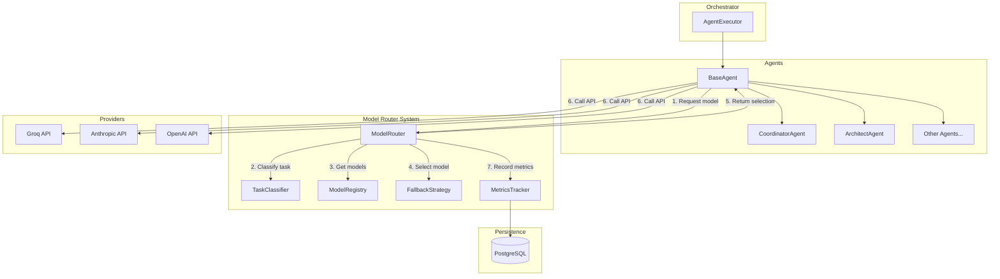
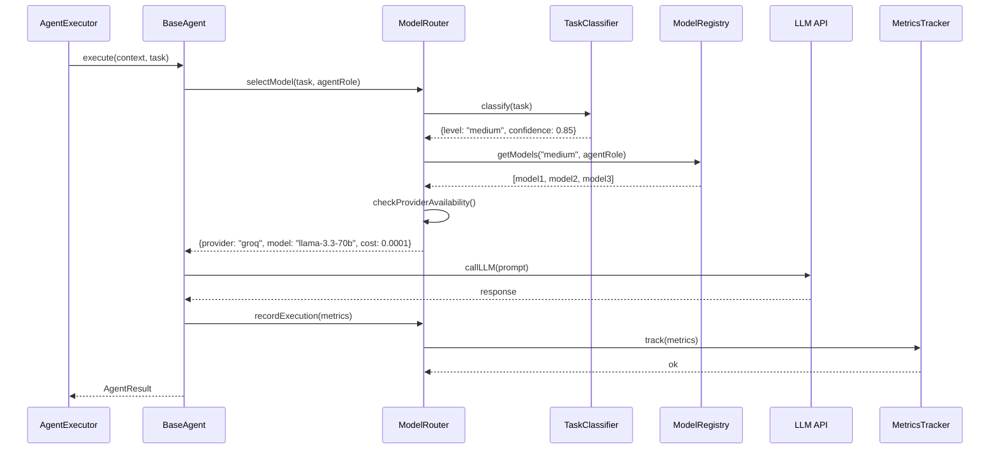
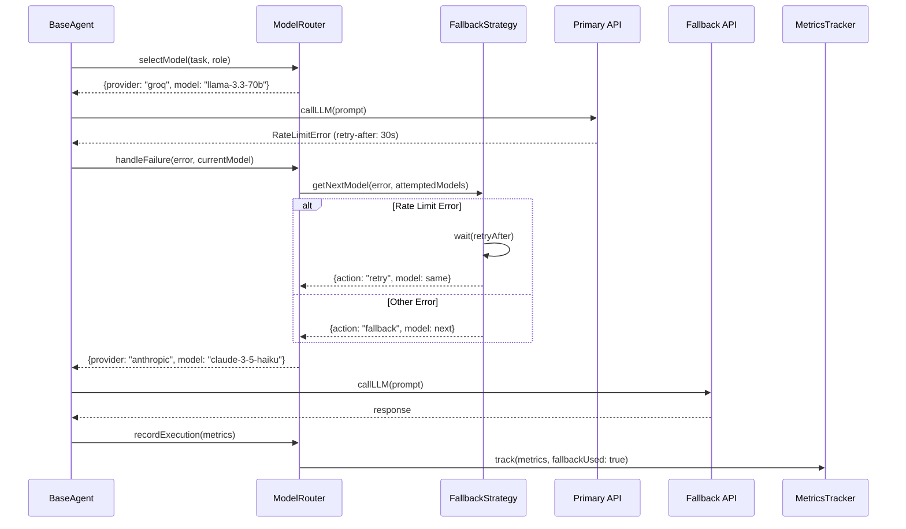

# Design Document: Model Router

## Overview

The Model Router is an intelligent LLM selection system that optimizes model usage across the AI DevOS platform. It analyzes incoming tasks, classifies their complexity, and routes them to the most appropriate model based on cost, speed, and capability requirements.

### Goals

- Reduce LLM costs by routing simple tasks to cheaper/faster models
- Maintain quality by ensuring complex tasks use capable models
- Provide automatic fallback when models fail or are rate-limited
- Enable per-agent model overrides for critical workflows
- Track usage metrics for cost analysis and optimization

### Non-Goals

- Fine-tuning or training models
- Caching LLM responses (handled separately)
- Managing conversation history (handled by agents)

## Architecture

The Model Router integrates between the `BaseAgent` class and LLM provider APIs, intercepting model selection before each API call.



### Sequence Diagram: Task Execution with Model Router



### Sequence Diagram: Fallback on Failure



## Components and Interfaces

### 1. ModelRouter (Core Component)

The central orchestrator that coordinates task classification, model selection, and metrics tracking.

```typescript
// src/model-router/model-router.ts

import type { AgentRole } from '../types/agents.js';

/** Complexity levels for task classification */
export type ComplexityLevel = 'simple' | 'medium' | 'complex';

/** LLM Provider identifiers */
export type Provider = 'groq' | 'anthropic' | 'openai';

/** Classification result from TaskClassifier */
export interface ClassificationResult {
  level: ComplexityLevel;
  confidence: number; // 0.0 to 1.0
  reasoning?: string;
}

/** Model selection result returned to BaseAgent */
export interface ModelSelection {
  provider: Provider;
  model: string;
  estimatedCostPer1KTokens: number;
  complexity: ComplexityLevel;
}

/** Execution metrics for tracking */
export interface ExecutionMetrics {
  provider: Provider;
  model: string;
  complexity: ComplexityLevel;
  inputTokens: number;
  outputTokens: number;
  latencyMs: number;
  success: boolean;
  error?: string;
  fallbackUsed: boolean;
  agentRole: AgentRole;
}

/** Model Router interface */
export interface IModelRouter {
  /**
   * Select the optimal model for a task.
   * Called by BaseAgent before LLM API calls.
   */
  selectModel(task: string, agentRole: AgentRole): Promise<ModelSelection>;
  
  /**
   * Handle model failure and get fallback.
   * Returns next model to try or null if all fallbacks exhausted.
   */
  handleFailure(
    error: Error,
    currentModel: ModelSelection,
    attemptedModels: ModelSelection[]
  ): Promise<ModelSelection | null>;
  
  /**
   * Record execution metrics after LLM call completes.
   */
  recordExecution(metrics: ExecutionMetrics): Promise<void>;
  
  /**
   * Check if Model Router is available.
   * BaseAgent falls back to default if false.
   */
  isAvailable(): boolean;
}
```

### 2. TaskClassifier (Sub-Agent)

Analyzes task descriptions to determine complexity level.

```typescript
// src/model-router/task-classifier.ts

import type { ComplexityLevel, ClassificationResult } from './model-router.js';

/** Criteria for complexity classification */
export interface ClassificationCriteria {
  simple: string[];  // Keywords/patterns for simple tasks
  medium: string[];  // Keywords/patterns for medium tasks
  complex: string[]; // Keywords/patterns for complex tasks
}

/** Task Classifier interface */
export interface ITaskClassifier {
  /**
   * Classify a task's complexity level.
   * Must complete within 2 seconds.
   */
  classify(task: string): Promise<ClassificationResult>;
  
  /**
   * Update classification criteria at runtime.
   */
  updateCriteria(criteria: Partial<ClassificationCriteria>): void;
}

/** Default classification criteria */
export const DEFAULT_CRITERIA: ClassificationCriteria = {
  simple: [
    'format', 'summarize', 'list', 'single file', 'rename',
    'simple', 'basic', 'quick', 'minor', 'typo', 'comment'
  ],
  medium: [
    'refactor', 'api', 'integration', 'multiple files', 'test',
    'implement', 'feature', 'update', 'modify', 'enhance'
  ],
  complex: [
    'architecture', 'design', 'security', 'performance', 'system',
    'cross-module', 'migration', 'optimization', 'scale', 'infrastructure'
  ]
};

/** Token thresholds for classification */
export const TOKEN_THRESHOLDS = {
  simple: 500,    // Under 500 tokens
  medium: 2000,   // Under 2000 tokens
  complex: 2000   // Over 2000 tokens
};
```

### 3. ModelRegistry (Configuration Store)

Stores and manages model configurations per complexity level and provider.

```typescript
// src/model-router/model-registry.ts

import type { ComplexityLevel, Provider } from './model-router.js';
import type { AgentRole } from '../types/agents.js';

/** Model configuration entry */
export interface ModelConfig {
  provider: Provider;
  model: string;
  costPer1KInputTokens: number;
  costPer1KOutputTokens: number;
  maxTokens: number;
  priority: number; // Lower = higher priority
}

/** Agent-specific override configuration */
export interface AgentOverride {
  agentRole: AgentRole;
  minimumComplexity?: ComplexityLevel;
  preferredProvider?: Provider;
  specificModel?: string;
  reason: string;
}

/** Model Registry interface */
export interface IModelRegistry {
  /**
   * Get available models for a complexity level.
   * Returns models sorted by priority.
   */
  getModels(level: ComplexityLevel): ModelConfig[];
  
  /**
   * Get agent-specific override if configured.
   */
  getAgentOverride(role: AgentRole): AgentOverride | null;
  
  /**
   * Update model configuration at runtime.
   * Validates that at least one model exists per level.
   */
  updateConfig(
    level: ComplexityLevel,
    models: ModelConfig[]
  ): void;
  
  /**
   * Set agent override.
   */
  setAgentOverride(override: AgentOverride): void;
  
  /**
   * Validate current configuration.
   * Throws if invalid.
   */
  validate(): void;
}

/** Default model mappings per complexity level */
export const DEFAULT_MODEL_MAPPINGS: Record<ComplexityLevel, ModelConfig[]> = {
  simple: [
    { provider: 'groq', model: 'llama-3.3-70b-versatile', costPer1KInputTokens: 0.00059, costPer1KOutputTokens: 0.00079, maxTokens: 32768, priority: 1 },
    { provider: 'anthropic', model: 'claude-3-5-haiku-20241022', costPer1KInputTokens: 0.001, costPer1KOutputTokens: 0.005, maxTokens: 8192, priority: 2 },
    { provider: 'openai', model: 'gpt-4o-mini', costPer1KInputTokens: 0.00015, costPer1KOutputTokens: 0.0006, maxTokens: 16384, priority: 3 },
  ],
  medium: [
    { provider: 'groq', model: 'llama-3.3-70b-versatile', costPer1KInputTokens: 0.00059, costPer1KOutputTokens: 0.00079, maxTokens: 32768, priority: 1 },
    { provider: 'anthropic', model: 'claude-sonnet-4-20250514', costPer1KInputTokens: 0.003, costPer1KOutputTokens: 0.015, maxTokens: 8192, priority: 2 },
    { provider: 'openai', model: 'gpt-4o', costPer1KInputTokens: 0.0025, costPer1KOutputTokens: 0.01, maxTokens: 16384, priority: 3 },
  ],
  complex: [
    { provider: 'anthropic', model: 'claude-opus-4-20250514', costPer1KInputTokens: 0.015, costPer1KOutputTokens: 0.075, maxTokens: 8192, priority: 1 },
    { provider: 'openai', model: 'gpt-4o', costPer1KInputTokens: 0.0025, costPer1KOutputTokens: 0.01, maxTokens: 16384, priority: 2 },
    { provider: 'groq', model: 'llama-3.3-70b-versatile', costPer1KInputTokens: 0.00059, costPer1KOutputTokens: 0.00079, maxTokens: 32768, priority: 3 },
  ],
};

/** Default agent overrides */
export const DEFAULT_AGENT_OVERRIDES: AgentOverride[] = [
  { agentRole: 'coordinator', minimumComplexity: 'medium', reason: 'Coordinator requires reliable task analysis' },
  { agentRole: 'architect', minimumComplexity: 'complex', reason: 'Architecture decisions require deep reasoning' },
];
```

### 4. FallbackStrategy (Error Handler)

Manages fallback logic when models fail.

```typescript
// src/model-router/fallback-strategy.ts

import type { ModelSelection, Provider } from './model-router.js';

/** Fallback action to take */
export type FallbackAction = 
  | { type: 'retry'; delayMs: number }
  | { type: 'fallback'; model: ModelSelection }
  | { type: 'escalate'; toLevel: 'medium' | 'complex' }
  | { type: 'fail'; reason: string };

/** Fallback attempt record */
export interface FallbackAttempt {
  model: ModelSelection;
  error: string;
  timestamp: Date;
}

/** Fallback Strategy interface */
export interface IFallbackStrategy {
  /**
   * Determine next action after a model failure.
   * 
   * @param error - The error that occurred
   * @param currentModel - The model that failed
   * @param attempts - Previous fallback attempts
   * @returns The action to take
   */
  getNextAction(
    error: Error,
    currentModel: ModelSelection,
    attempts: FallbackAttempt[]
  ): Promise<FallbackAction>;
  
  /**
   * Check if error is a rate limit error.
   */
  isRateLimitError(error: Error): boolean;
  
  /**
   * Extract retry-after duration from rate limit error.
   */
  getRetryAfterMs(error: Error): number | null;
}

/** Maximum fallback attempts before failing */
export const MAX_FALLBACK_ATTEMPTS = 3;
```

### 5. MetricsTracker (Usage Analytics)

Tracks and persists usage metrics to PostgreSQL.

```typescript
// src/model-router/metrics-tracker.ts

import type { ExecutionMetrics, Provider, ComplexityLevel } from './model-router.js';

/** Aggregated metrics for reporting */
export interface AggregatedMetrics {
  provider: Provider;
  model: string;
  complexity: ComplexityLevel;
  totalExecutions: number;
  successfulExecutions: number;
  totalInputTokens: number;
  totalOutputTokens: number;
  totalCost: number;
  averageLatencyMs: number;
  fallbackCount: number;
}

/** Time range for metrics queries */
export interface TimeRange {
  start: Date;
  end: Date;
}

/** Metrics Tracker interface */
export interface IMetricsTracker {
  /**
   * Record a single execution's metrics.
   */
  track(metrics: ExecutionMetrics): Promise<void>;
  
  /**
   * Get aggregated metrics for a time range.
   */
  getAggregated(
    range: TimeRange,
    groupBy?: ('provider' | 'model' | 'complexity')[]
  ): Promise<AggregatedMetrics[]>;
  
  /**
   * Get total cost for a time range.
   */
  getTotalCost(range: TimeRange): Promise<number>;
  
  /**
   * Clean up metrics older than retention period.
   */
  cleanup(retentionDays: number): Promise<number>;
}

/** Metrics retention period in days */
export const METRICS_RETENTION_DAYS = 30;
```

### 6. ProviderHealthChecker (Availability Monitor)

Monitors provider health and availability.

```typescript
// src/model-router/provider-health.ts

import type { Provider } from './model-router.js';

/** Provider health status */
export interface ProviderHealth {
  provider: Provider;
  available: boolean;
  lastCheck: Date;
  lastError?: string;
  consecutiveFailures: number;
}

/** Provider Health Checker interface */
export interface IProviderHealthChecker {
  /**
   * Check if a provider is currently available.
   */
  isAvailable(provider: Provider): boolean;
  
  /**
   * Get health status for all providers.
   */
  getHealthStatus(): Map<Provider, ProviderHealth>;
  
  /**
   * Mark a provider as temporarily unavailable.
   */
  markUnavailable(provider: Provider, durationMs: number): void;
  
  /**
   * Start periodic health checks.
   */
  startHealthChecks(intervalMs: number): void;
  
  /**
   * Stop periodic health checks.
   */
  stopHealthChecks(): void;
}

/** Health check interval in milliseconds (5 minutes) */
export const HEALTH_CHECK_INTERVAL_MS = 5 * 60 * 1000;

/** Unavailability duration after health check failure (1 minute) */
export const UNAVAILABLE_DURATION_MS = 60 * 1000;
```

## Data Models

### Database Schema Extension

Add a new table for model usage metrics to the existing PostgreSQL schema:

```typescript
// Addition to src/persistence/schema.ts

import {
  pgTable,
  text,
  timestamp,
  integer,
  uuid,
  index,
  boolean,
  real,
} from 'drizzle-orm/pg-core';

// ============================================================================
// Model Usage Metrics (Model Router tracking)
// ============================================================================
export const modelUsageMetrics = pgTable(
  'model_usage_metrics',
  {
    id: uuid('id').primaryKey().defaultRandom(),
    provider: text('provider').notNull(), // 'groq' | 'anthropic' | 'openai'
    model: text('model').notNull(),
    complexity: text('complexity').notNull(), // 'simple' | 'medium' | 'complex'
    agentRole: text('agent_role').notNull(),
    inputTokens: integer('input_tokens').notNull(),
    outputTokens: integer('output_tokens').notNull(),
    latencyMs: integer('latency_ms').notNull(),
    estimatedCost: real('estimated_cost').notNull(),
    success: boolean('success').notNull(),
    error: text('error'),
    fallbackUsed: boolean('fallback_used').notNull().default(false),
    fallbackChain: text('fallback_chain'), // JSON array of attempted models
    createdAt: timestamp('created_at', { withTimezone: true }).notNull().defaultNow(),
  },
  (table) => [
    index('idx_metrics_provider').on(table.provider),
    index('idx_metrics_model').on(table.model),
    index('idx_metrics_complexity').on(table.complexity),
    index('idx_metrics_agent_role').on(table.agentRole),
    index('idx_metrics_created_at').on(table.createdAt),
    index('idx_metrics_success').on(table.success),
  ]
);

// Type exports
export type ModelUsageMetric = typeof modelUsageMetrics.$inferSelect;
export type NewModelUsageMetric = typeof modelUsageMetrics.$inferInsert;
```

### Configuration Schema

Runtime configuration stored in memory with optional persistence:

```typescript
// src/model-router/config-schema.ts

import type { ComplexityLevel, Provider } from './model-router.js';
import type { AgentRole } from '../types/agents.js';
import type { ModelConfig, AgentOverride } from './model-registry.js';

/** Complete Model Router configuration */
export interface ModelRouterConfig {
  /** Model mappings per complexity level */
  modelMappings: Record<ComplexityLevel, ModelConfig[]>;
  
  /** Agent-specific overrides */
  agentOverrides: AgentOverride[];
  
  /** Provider API keys (read from environment) */
  providerKeys: Partial<Record<Provider, string>>;
  
  /** Preferred provider (from LLM_PROVIDER env var) */
  preferredProvider: Provider;
  
  /** Classification criteria */
  classificationCriteria: {
    simple: string[];
    medium: string[];
    complex: string[];
  };
  
  /** Fallback settings */
  fallback: {
    maxAttempts: number;
    escalateOnExhaustion: boolean;
  };
  
  /** Health check settings */
  healthCheck: {
    intervalMs: number;
    unavailableDurationMs: number;
  };
  
  /** Metrics settings */
  metrics: {
    retentionDays: number;
    enabled: boolean;
  };
}
```


## Correctness Properties

*A property is a characteristic or behavior that should hold true across all valid executions of a system—essentially, a formal statement about what the system should do. Properties serve as the bridge between human-readable specifications and machine-verifiable correctness guarantees.*

### Property 1: Classification Output Validity

*For any* task string submitted to the TaskClassifier, the classification result SHALL contain a valid complexity level (one of 'simple', 'medium', 'complex') AND a confidence score between 0.0 and 1.0 inclusive.

**Validates: Requirements 1.1, 1.6**

### Property 2: Simple Task Classification

*For any* task description containing simple-task indicators (single-file changes, text formatting, simple CRUD operations, summarization, or estimated output under 500 tokens), the TaskClassifier SHALL assign a complexity level of 'simple'.

**Validates: Requirements 1.2**

### Property 3: Medium Task Classification

*For any* task description containing medium-task indicators (multi-file changes, API integrations, moderate refactoring, or code generation under 2000 tokens), the TaskClassifier SHALL assign a complexity level of 'medium'.

**Validates: Requirements 1.3**

### Property 4: Complex Task Classification

*For any* task description containing complex-task indicators (architectural decisions, system design, cross-module refactoring, security analysis, or code generation over 2000 tokens), the TaskClassifier SHALL assign a complexity level of 'complex'.

**Validates: Requirements 1.4**

### Property 5: Registry Configuration Invariant

*For any* valid configuration update to the ModelRegistry, after the update completes, every complexity level ('simple', 'medium', 'complex') SHALL have at least one model configured. Invalid configurations (empty model arrays, missing levels) SHALL be rejected with a descriptive error.

**Validates: Requirements 2.5, 2.6**

### Property 6: Model Selection Priority

*For any* task with a classified complexity level, the ModelRouter SHALL select a model that: (1) exists in the registry for that complexity level, (2) belongs to the preferred provider if that provider has a valid API key, and (3) follows cost-efficiency ordering when multiple models from the preferred provider are available.

**Validates: Requirements 3.1, 3.2, 3.3**

### Property 7: API Key Availability Affects Selection

*For any* model selection request, if the preferred provider lacks a valid API key, the ModelRouter SHALL select a model from an alternative provider that has a valid API key. Models from providers without valid API keys SHALL never be selected.

**Validates: Requirements 3.4, 3.5**

### Property 8: Rate Limit Retry Behavior

*For any* model execution that fails with a rate limit error containing a retry-after duration, the ModelRouter SHALL wait for the specified duration and retry exactly once with the same model before attempting fallback.

**Validates: Requirements 4.1**

### Property 9: Non-Rate-Limit Fallback

*For any* model execution that fails with a non-rate-limit error, the ModelRouter SHALL immediately select the next available model from the same complexity level without waiting.

**Validates: Requirements 4.2**

### Property 10: Complexity Escalation on Exhaustion

*For any* complexity level where all configured models have failed, the ModelRouter SHALL escalate to the next higher complexity level ('simple' → 'medium' → 'complex') and attempt models from that level.

**Validates: Requirements 4.3**

### Property 11: Comprehensive Failure Reporting

*For any* scenario where all fallback attempts fail, the returned error SHALL contain details of every attempted model including: provider name, model name, and the specific failure reason for each attempt.

**Validates: Requirements 4.4**

### Property 12: Maximum Fallback Attempts

*For any* failing execution, the ModelRouter SHALL attempt at most 3 fallback models before returning a final error. The total number of model attempts (including the initial attempt) SHALL not exceed 4.

**Validates: Requirements 4.5**

### Property 13: Model Selection Result Format

*For any* successful model selection, the returned ModelSelection object SHALL contain: a valid provider identifier, a non-empty model name string, and a non-negative estimated cost per 1K tokens.

**Validates: Requirements 5.3**

### Property 14: Metrics Contain Required Fields

*For any* recorded execution metric, the metric record SHALL contain all required fields: provider, model name, complexity level, input token count, output token count, latency in milliseconds, and success status.

**Validates: Requirements 6.1**

### Property 15: Cost Calculation Accuracy

*For any* execution with known input tokens, output tokens, and provider pricing, the calculated estimated cost SHALL equal: (inputTokens / 1000 * inputCostPer1K) + (outputTokens / 1000 * outputCostPer1K).

**Validates: Requirements 6.2**

### Property 16: Provider Unavailability Handling

*For any* provider with a missing API key OR a failed health check, that provider SHALL be marked as unavailable. After a health check failure, the provider SHALL remain unavailable for exactly 1 minute before becoming eligible for selection again.

**Validates: Requirements 7.3, 7.6**

### Property 17: Agent Override Application

*For any* agent with a configured override, the ModelRouter SHALL apply the override instead of complexity-based selection. If the override specifies a minimum complexity level, tasks classified below that level SHALL be elevated. If the override specifies a preferred provider or specific model, that SHALL be used regardless of default priority.

**Validates: Requirements 8.2, 8.3**

## Error Handling

### Classification Errors

| Error Condition | Handling Strategy |
|----------------|-------------------|
| Task string is empty or null | Return 'medium' complexity with 0.5 confidence as safe default |
| Classification timeout (>2s) | Return 'medium' complexity with 0.3 confidence, log warning |
| Internal classifier error | Return 'medium' complexity with 0.3 confidence, log error |

### Model Selection Errors

| Error Condition | Handling Strategy |
|----------------|-------------------|
| No models configured for level | Escalate to next higher level; if 'complex', return error |
| All providers unavailable | Return error with list of unavailable providers |
| Registry not initialized | Return error, BaseAgent uses default model |

### Execution Errors

| Error Condition | Handling Strategy |
|----------------|-------------------|
| Rate limit (429) | Wait retry-after duration, retry once, then fallback |
| Authentication error (401/403) | Mark provider unavailable, fallback immediately |
| Server error (5xx) | Fallback immediately to next model |
| Timeout | Fallback immediately to next model |
| Network error | Fallback immediately to next model |

### Metrics Errors

| Error Condition | Handling Strategy |
|----------------|-------------------|
| Database unavailable | Queue metrics in memory (max 1000), retry on reconnect |
| Invalid metric data | Log error, skip recording, don't fail execution |
| Aggregation query timeout | Return partial results with warning |

## Testing Strategy

### Unit Tests

Unit tests verify specific behaviors with concrete examples:

1. **TaskClassifier**
   - Classification of known simple tasks (formatting, single-file)
   - Classification of known medium tasks (API integration, refactoring)
   - Classification of known complex tasks (architecture, security)
   - Confidence score boundaries (0.0, 0.5, 1.0)
   - Timeout handling

2. **ModelRegistry**
   - Default configuration loading
   - Configuration validation (reject empty arrays)
   - Agent override retrieval
   - Runtime configuration updates

3. **FallbackStrategy**
   - Rate limit error detection
   - Retry-after extraction
   - Fallback model selection
   - Escalation logic

4. **MetricsTracker**
   - Cost calculation with known values
   - Aggregation grouping
   - Time range filtering
   - Retention cleanup

### Property-Based Tests

Property tests verify universal properties across generated inputs. Each test runs minimum 100 iterations.

```typescript
// Example property test structure
describe('Model Router Properties', () => {
  // Feature: model-router, Property 1: Classification Output Validity
  it('should always return valid classification output', async () => {
    await fc.assert(
      fc.asyncProperty(fc.string(), async (task) => {
        const result = await classifier.classify(task);
        expect(['simple', 'medium', 'complex']).toContain(result.level);
        expect(result.confidence).toBeGreaterThanOrEqual(0.0);
        expect(result.confidence).toBeLessThanOrEqual(1.0);
      }),
      { numRuns: 100 }
    );
  });

  // Feature: model-router, Property 5: Registry Configuration Invariant
  it('should maintain at least one model per level after any valid update', async () => {
    await fc.assert(
      fc.asyncProperty(arbitraryValidConfig(), async (config) => {
        registry.updateConfig(config);
        for (const level of ['simple', 'medium', 'complex']) {
          expect(registry.getModels(level).length).toBeGreaterThan(0);
        }
      }),
      { numRuns: 100 }
    );
  });

  // Feature: model-router, Property 12: Maximum Fallback Attempts
  it('should attempt at most 3 fallback models', async () => {
    await fc.assert(
      fc.asyncProperty(arbitraryTask(), async (task) => {
        const attempts: string[] = [];
        // Configure all models to fail
        mockAllModelsToFail((model) => attempts.push(model));
        
        try {
          await router.selectModel(task, 'developer');
        } catch (error) {
          // Expected to fail
        }
        
        expect(attempts.length).toBeLessThanOrEqual(4); // 1 initial + 3 fallbacks
      }),
      { numRuns: 100 }
    );
  });
});
```

### Integration Tests

1. **BaseAgent Integration**
   - Verify BaseAgent calls ModelRouter.selectModel()
   - Verify BaseAgent uses returned model/provider
   - Verify fallback to default when ModelRouter unavailable

2. **Database Integration**
   - Verify metrics persistence to PostgreSQL
   - Verify metrics retrieval with time range
   - Verify cleanup respects retention period

3. **Provider Health Checks**
   - Verify health checks run on startup
   - Verify periodic health checks (mocked timer)
   - Verify unavailability marking after failure

### Test Configuration

```typescript
// vitest.config.ts additions
export default defineConfig({
  test: {
    // Property test timeout (longer due to iterations)
    testTimeout: 30000,
    
    // Coverage thresholds
    coverage: {
      thresholds: {
        'src/model-router/**': {
          statements: 80,
          branches: 75,
          functions: 80,
          lines: 80,
        },
      },
    },
  },
});
```
